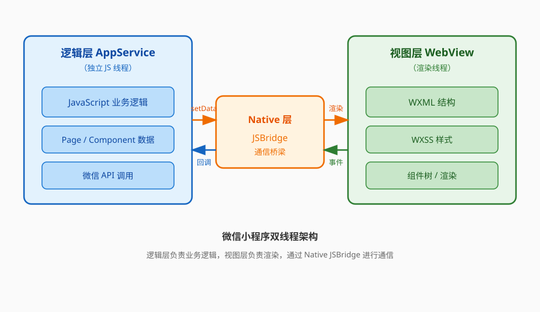
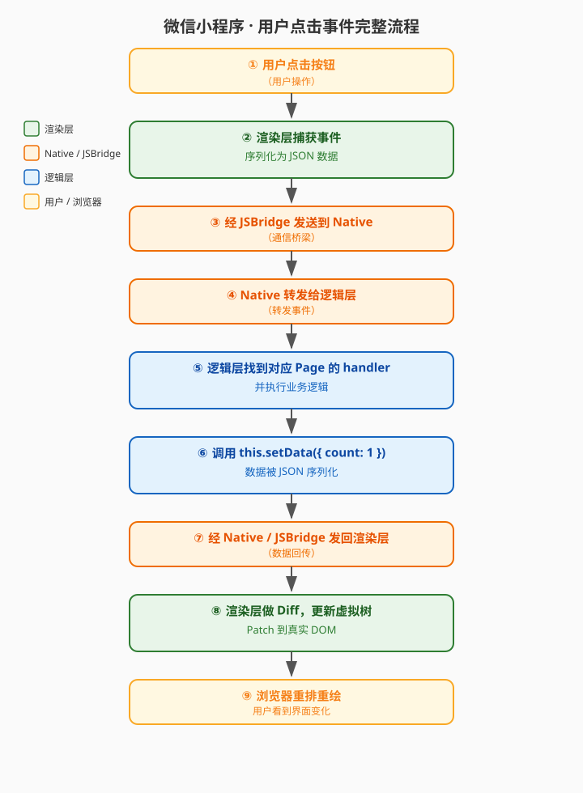
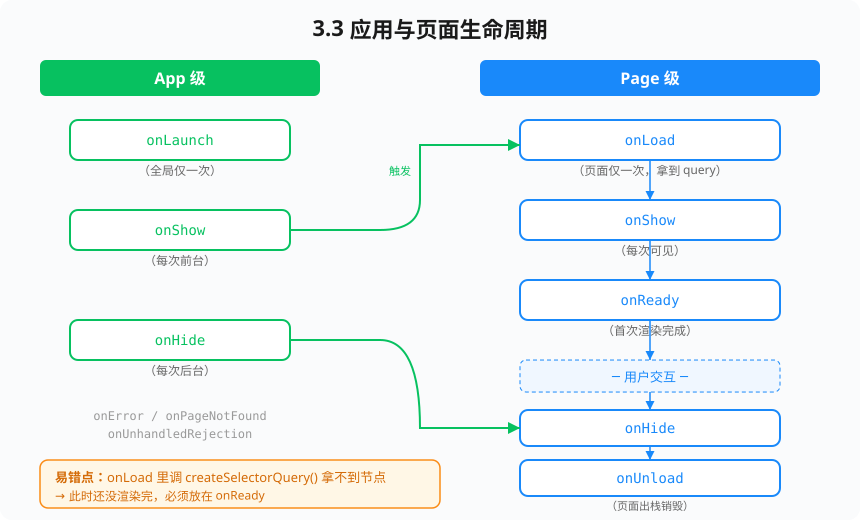
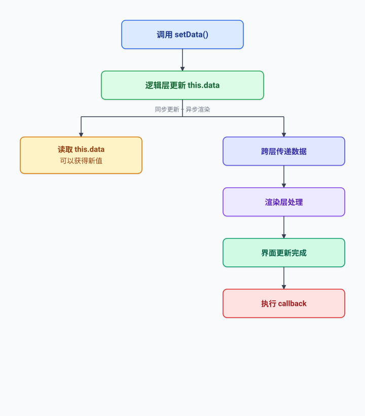

<!-- _class: cover_e -->
<!-- _paginate: "" -->
<!-- _footer:  -->
<!-- _header:  -->

# 第一章 小程序架构原理与运行机制

###### “不知其所以然者，虽能行之，不能变也。”

张丽，井明
数据科学与计算机学院
jingming@sdu.edu.cn
2026年秋

---

<!-- _header: 目录<br>CONTENTS<br>-->
<!-- _class: toc_b -->
<!-- _footer: "" -->
<!-- _paginate: "" -->

- 从"会用"到"懂原理"
- 双线程架构
- 启动流程与生命周期
- Exparser 与渲染管线
- setData：通信的代价
- 宿主环境差异与兼容

---

<!-- _class: trans -->
<!-- _paginate: "" -->

## 第一节 从"会用"到"懂原理"

---

## 1.1 这门课解决什么问题

基础课教的是**会写**：`wx.request`、`Page`、`wx:for`、`bindtap`。

高级课教的是**懂原理 + 能决策**：

- 页面卡了，卡在哪一层？是逻辑层算得慢，还是渲染层重排？
- 首屏 3 秒，时间花在下载、注入、还是首次渲染？
- 组件该拆到多细？状态该放 `data`、`globalData` 还是 MobX Store？
- 这个需求该用原生组件、WebView 还是跨端框架？

> 判断力来自对**运行机制**的理解，而不是 API 文档的记忆量。

---

## 1.2 小程序不是"套壳网页"

| | Web 页面 | 小程序 |
|---|---|---|
| 运行环境 | 浏览器，单一 JS 环境 | 双线程，逻辑与渲染隔离 |
| DOM 访问 | 可直接操作 | **禁止**，无 `document` / `window` |
| 页面跳转 | URL 驱动，整页刷新 | 页面栈，最多 10 层 |
| 代码分发 | 按需请求资源 | 提前打包上传，审核后下发 |
| 能力边界 | 受同源策略约束 | 受微信开放能力与域名白名单约束 |

>这些差异不是"限制"，而是**架构选择的结果**——理解了原因，就知道哪些限制能绕、哪些不能。

---

## 1.3 三个设计目标

微信团队在设计小程序运行时的时候，同时要满足：

1. **安全** —— 开发者代码不能拿到用户的原始 DOM、Cookie、其他小程序的数据；
2. **可管控** —— 平台需要能审核、能拦截、能统一降级；
3. **体验接近原生** —— 启动快、滚动跟手、组件（地图/视频）用系统实现。

<br>

**双线程模型**正是这三个目标的交集：把开发者的 JS 关进一个没有 DOM 的沙箱里，
让渲染交给平台可控的 WebView / Skyline。

---

<!-- _class: trans -->
<!-- _paginate: "" -->

## 第二节 双线程架构


---

## 2.1 整体结构

---

<!-- _footer: '' -->



---


## 2.2 为什么逻辑层没有 DOM

逻辑层跑在一个"裁剪过的" JS 引擎里：

- iOS：`JavaScriptCore`
- Android：早期 X5 JS 引擎，现为 **V8**
- 开发者工具：`nwjs` 的独立进程（**所以工具和真机行为会不一致**）

<br>

这些环境**只提供 ECMAScript 标准能力**，没有 BOM/DOM：

```js
console.log(typeof window)    // "undefined"
console.log(typeof document)  // "undefined"
console.log(typeof XMLHttpRequest) // "undefined"
```

引入 npm 包时，凡是访问 `window`、`document`、`localStorage` 的库都会直接崩——
这是"构建 npm"环节最常见的报错来源。

---

<!-- _footer: '' -->



---

## 2.3 一次点击的完整链路

<!-- _class: smalltext -->

```text
用户点击按钮
  ↓ ① 渲染层捕获事件，序列化为 JSON
  ↓ ② 经 JSBridge 发到 Native
  ↓ ③ Native 转发给逻辑层
  ↓ ④ 逻辑层找到对应 Page 的 handler 并执行
  ↓ ⑤ 业务调用 this.setData({ count: 1 })
  ↓ ⑥ 数据被 JSON 序列化，经 Native 发回渲染层
  ↓ ⑦ 渲染层做 diff，更新虚拟树，patch 到真实 DOM
  ↓ ⑧ 浏览器重排重绘，用户看到变化
```

<br>

**8 个步骤里有 4 次跨线程通信**。这就是为什么"少 setData、小 setData"是小程序性能的第一原则。

---

## 2.4 双线程的代价与收益

<!-- _class: cols-2 -->

<div class="ldiv">

**收益**

- 业务 JS 无法污染/窥探渲染层
- 逻辑层长任务不会直接阻塞滚动
- 平台可统一注入基础库、灰度修 Bug
- 渲染层可替换（WebView → Skyline）

</div>

<div class="rdiv">

**代价**

- 所有交互都有**序列化开销**
- 无法同步拿到节点信息，
  查询要走 `SelectorQuery` 的异步回调
- 传大对象、传函数会失败或极慢
- 首次渲染多一轮通信，启动更慢

</div>

---

## 2.5 实测：序列化开销

<!-- _class: smalltext -->

```js
// pages/bench/bench.js
Page({
  data: { list: [] },
  benchSetData() {
    const big = Array.from({ length: 2000 }, (_, i) => ({
      id: i, title: `item-${i}`, desc: 'x'.repeat(200)
    }))
    const t0 = Date.now()
    this.setData({ list: big }, () => {
      // 回调在渲染层完成渲染后触发
      console.log('setData 往返耗时', Date.now() - t0, 'ms')
    })
  }
})
```

在中端 Android 上，这段代码往返通常在 **300–800ms**。
把 `desc` 去掉后往往降到 **80ms 以内**——**体积**而非**条数**是主要成本。

---

## 2.6 传不过去的东西

`setData` 的数据要经过 `JSON.stringify` 等价的序列化，因此：

```js
this.setData({
  fn: () => {},                 // ✗ 丢失
  date: new Date(),             // ✗ 变成字符串，模板里无法调用方法
  undef: undefined,             // ✗ 被丢弃，无法用于"删除字段"
  regexp: /abc/,                // ✗ 变成 {}
  circular: objWithCycle,       // ✗ 直接报错
  big: base64Of5MB              // ✗ 能传，但会卡死
})
```

**规范**：`setData` 只传**渲染需要的、可 JSON 化的、尽量扁平的**数据。
格式化（日期、金额、截断）应在逻辑层做完，或交给 **WXS**（第二章）。

---

<!-- _class: trans -->
<!-- _paginate: "" -->

## 第三节 启动流程与生命周期

---

## 3.1 冷启动的六个阶段

<!-- _class: smalltext -->

| 阶段 | 做了什么 | 可优化点 |
|---|---|---|
| ① 资源准备 | 校验版本、下载代码包 | 减小包体、分包 |
| ② 环境初始化 | 启动双线程、注入基础库 | 平台负责，不可控 |
| ③ 代码注入 | 执行 `app.js` 与所有页面的 `Page()` 注册 | **避免顶层重逻辑** |
| ④ `onLaunch` / `onShow` | App 生命周期 | 避免同步阻塞 |
| ⑤ 首页 `onLoad` → 首次渲染 | 初始 data 上屏 | 初始 data 要小 |
| ⑥ `onReady` 后的数据请求 | 业务数据回填 | 请求提前、并行 |

<br>

**热启动**跳过 ①②③，只走 `onShow`。所以"首次进入慢、再进就快"是正常现象，
但**不能拿热启动的数据去汇报性能**。

---

## 3.2 代码注入阶段的陷阱

```js
// app.js —— 反面教材
const heavyConfig = require('./config/all-cities.js')  // 800KB JSON
const dayjs = require('dayjs')                          // 未按需引入
initTracker()                                           // 同步埋点初始化
wx.getSystemInfoSync()                                  // 同步 API

App({ onLaunch() { /* ... */ } })
```

`app.js` 顶层的每一行都会**串行地**计入启动耗时。

---

**改法**：

```js
App({
  onLaunch() {
    // 非首屏依赖的一律延后
    wx.nextTick(() => initTracker())
  },
  // 用 getter 做懒加载
  get cities() { return require('./config/all-cities.js') }
})
```

---
<!-- _class: smalltext -->

get 语法是什么？get 是 JavaScript 访问器属性（Getter），
访问属性时自动执行函数，常用于懒加载和计算属性。

基本写法:

```js
Page({
  // ✅ 写在 Page / Component 根对象上
  get heavyData() {
    if (!this._cache) {
      console.log('第一次访问才计算');
      this._cache = this._compute();   // 懒加载
    }
    return this._cache;
  },

  _compute() {
    return Array.from({ length: 10000 }, (_, i) => ({ id: i }));
  }
});
```
使用方式：this.heavyData（不用加括号）

---

**核心特点（一张表记牢）**

| 点              | 说明                              |
|-----------------|-----------------------------------|
| 触发时机        | 真正访问属性时才执行              |
| 缓存            | 自己写 `_cache`，后续直接返回     |
| 不能写在 data   | data 只能放普通数据               |
| 不是响应式      | 改了要手动 `setData` 才能更新视图 |
| 官方无特殊支持  | 纯 JS 语法，小程序完全支持        |

**一句话总结**
**用 get 做懒加载：第一次访问才计算，后续直接用缓存。**

---

<!-- _footer: '' -->




---

## 3.4 页面栈与实例

```js
const pages = getCurrentPages()
const current = pages[pages.length - 1]
const prev = pages[pages.length - 2]

// 回退时把数据带回上一页（比 URL 传参更适合复杂对象）
prev.setData({ selectedAddress: addr })
wx.navigateBack()
```

约束：

- 页面栈最深 **10 层**，超出 `navigateTo` 静默失败；
- `redirectTo` 替换栈顶，`switchTab` 清空非 tab 页，`reLaunch` 清空整个栈；
- **不要长期持有其他页面的实例**，页面 `onUnload` 后引用会导致内存泄漏。

---

## 3.5 生命周期里"该做什么"

<!-- _class: smalltext -->

| 钩子 | 适合做 | 不适合做 |
|---|---|---|
| `App.onLaunch` | 读缓存、拿启动参数 | 网络请求串行等待、重计算 |
| `Page.onLoad` | 解析 query、发起首屏请求 | 节点查询、动画 |
| `Page.onShow` | 刷新可能过期的数据 | 无条件重新请求全部数据 |
| `Page.onReady` | `SelectorQuery`、`IntersectionObserver`、canvas | 首屏关键请求（太晚） |
| `Page.onHide` | 暂停计时器/音视频、上报停留时长 | 释放还要用的资源 |
| `Page.onUnload` | 清定时器、取消监听、`abort` 请求 | 依赖 `setData`（已无效） |

---

## 3.6 一定要写的清理逻辑

```js
Page({
  onLoad() {
    this._timer = setInterval(() => this.tick(), 1000)
    this._task = wx.request({ url: API, success: this.onData })
    this._onNet = res => this.setData({ offline: !res.isConnected })
    wx.onNetworkStatusChange(this._onNet)
  },
  onUnload() {
    clearInterval(this._timer)
    this._task && this._task.abort()
    wx.offNetworkStatusChange(this._onNet)
  }
})
```

> 忘记清理是小程序内存泄漏与"页面已销毁仍 setData"报错的头号原因。

---

<!-- _class: trans -->
<!-- _paginate: "" -->

## 第四节 Exparser 与渲染管线

---

## 4.1 Exparser 是什么

**Exparser** 是小程序的自研组件系统，运行在渲染层，负责：

- 维护一棵**虚拟节点树**（Shadow Tree），实现组件的隔离与组合；
- 实现 `slot`、`properties`、事件冒泡/捕获等 Web Components 语义；
- 在数据变更时做 diff，把最小变更 patch 到真实 DOM。

<br>

它**不依赖浏览器原生 Custom Elements**，因此在 iOS/Android/开发者工具上行为一致，
也让同一套组件模型可以在 Skyline（非 WebView）下复用。

---

## 4.2 编译产物

一个页面在上传时会被编译成三部分：

<!-- _class: smalltext -->

| 源文件 | 产物 | 说明 |
|---|---|---|
| `.wxml` | JS 函数（生成虚拟节点树） | 不是 HTML 字符串，是可执行的"树工厂" |
| `.wxss` | 转换后的 CSS | `rpx` → 运行时按屏宽换算；补全前缀；作用域改写 |
| `.js` | 打包进逻辑层 bundle | 与 WXML 完全分离 |
| `.json` | 配置，参与组件解析 | `usingComponents` 决定标签如何解析 |

<br>

**推论**：WXML 里不能写任意 JS 表达式（只支持受限子集），因为它要能被静态编译成树工厂。

---

## 4.3 rpx 的换算规则

$$
\text{px} = \text{rpx} \times \frac{\text{屏幕宽度}}{750}
$$

| 设备 | 屏宽 | 1rpx |
|---|---|---|
| iPhone 6/7/8 | 375px | 0.5px |
| iPhone 6/7/8 Plus | 414px | 0.552px |
| iPad Pro | 1024px | 1.365px |

<br>

**注意**：在大屏（iPad、PC 端小程序）上 `rpx` 会等比放大到很夸张。
生产项目通常给容器加 `max-width` 或对宽屏切换 `px` 布局。

---

## 4.4 样式隔离

组件默认**样式隔离**：外部样式进不来，组件样式出不去。

```js
Component({
  options: {
    styleIsolation: 'isolated'   // 默认，双向隔离
    // 'apply-shared'  页面样式能影响组件，反之不行
    // 'shared'        双向共享（慎用）
  },
  externalClasses: ['custom-class']   // 显式开放的样式接口
})
```

```html
<!-- 使用方 -->
<my-card custom-class="card-lg" />
```


**设计建议**：组件对外只暴露 1–3 个 `externalClasses` + CSS 变量，
不要用 `shared` 图省事——那等于放弃组件封装。

---

## 4.5 用 CSS 变量做主题

```css
/* app.wxss */
page {
  --brand: #551645;
  --radius: 12rpx;
}
```

```css
/* components/card/card.wxss —— 即使 isolated，CSS 变量也能穿透 */
.card {
  border-radius: var(--radius, 8rpx);
  border-left: 6rpx solid var(--brand, #333);
}
```

CSS 自定义属性**继承自 DOM 树**，不受 Exparser 样式隔离影响，
是组件库做主题化最干净的方案。

---

## 4.6 原生组件与同层渲染

`camera`、`video`、`map`、`canvas`、`input`（部分场景）由**客户端原生控件**实现。

<!-- _class: cols-2 -->

<div class="ldiv">

**旧模型（层级最高）**

- 永远盖在所有 WXML 之上
- `z-index` 无效
- 只能用 `cover-view` / `cover-image` 覆盖

</div>

<div class="rdiv">

**同层渲染（现行）**

- 原生控件被插进 WebView 同一层级
- `z-index` 正常生效
- 仍有限制：不支持部分 CSS 滤镜、
  在 `scroll-view` 内滚动可能有拖影

</div>

<br>

遇到"视频盖住了弹窗"，第一步是确认基础库版本与是否命中同层渲染。

---

<!-- _class: trans -->
<!-- _paginate: "" -->

## 第五节 setData：通信的代价

---

## 5.1 setData 做了什么

```js
this.setData(data, callback)
```

1. 将 `data` 与当前 `this.data` **合并**（逻辑层立即生效，同步）；
2. 序列化后经 Native 发往渲染层（**异步**）；
3. 渲染层执行 diff + patch，完成后回调 `callback`。

<br>

```js
this.setData({ a: 1 })
console.log(this.data.a)  // 1  —— 逻辑层是同步的
// 但此刻界面还没更新，SelectorQuery 拿到的是旧尺寸
```

---

## 5.2 四条硬规则

<!-- _class: smalltext -->

**① 只传变化的部分，用数据路径**

```js
// ✗ 整个数组回传，10000 条全部序列化
this.data.list[3].checked = true
this.setData({ list: this.data.list })

// ✓ 只传一个字段
this.setData({ 'list[3].checked': true })
```

**② 合并多次调用**

```js
// ✗ 三次跨线程通信
this.setData({ a: 1 }); this.setData({ b: 2 }); this.setData({ c: 3 })
// ✓ 一次
this.setData({ a: 1, b: 2, c: 3 })
```

---

## 5.2 四条硬规则（续）

<!-- _class: smalltext -->

**③ 不渲染的数据不要放 data**

```js
Page({
  data: { list: [] },
  onLoad() {
    wx.request({ url: API, success: ({ data }) => {
      this._raw = data                    // 原始响应挂实例，不进 data
      this.setData({ list: data.items.map(pick) })
    }})
  }
})
function pick(it) { return { id: it.id, title: it.title, price: it.price } }
```

---


**④ 高频事件必须节流**

```js
onScroll(e) {
  const y = e.detail.scrollTop
  if (Math.abs(y - this._lastY) < 50) return   // 位移阈值
  this._lastY = y
  this.setData({ showTop: y > 600 })           // 状态没变时不 setData
}
```

---

## 5.3 setData 的三个典型反模式

<!-- _class: smalltext -->

```js
// 反模式 1：把 UI 状态和业务数据混在一个大对象里
this.setData({ page: { ...this.data.page, loading: false } })   // 整对象重传

// 反模式 2：在循环里 setData
list.forEach((it, i) => this.setData({ [`list[${i}].done`]: true }))  // N 次通信
// 正确：先攒成一个对象
const patch = {}
list.forEach((it, i) => { patch[`list[${i}].done`] = true })
this.setData(patch)

// 反模式 3：把 setData 当计算触发器
this.setData({ total: this.calcTotal() })   // 每次都全量算
// 正确：计算依赖不变就不算，或交给下一章的 observers
```

---

## 5.4 度量而不是猜测

开发者工具 → **Trace Panel / 性能面板**，重点看：

- `setData` 的**调用次数**与**数据大小**（面板会直接标红超过 256KB 的调用）；
- 逻辑层 **Evaluate Script** 的长任务；
- 渲染层 **Recalculate Style / Layout** 的占比。

<br>

真机上用：

```js
wx.setEnableDebug({ enableDebug: true })   // 打开真机 vConsole
const perf = wx.getPerformance()
perf.createObserver(list => console.log(list.getEntries())).observe({ entryTypes: ['render', 'script'] })
```

> 第九章会系统讲性能指标体系；这里先建立"任何优化都要有 before/after 数字"的习惯。

---

<!-- _class: trans -->
<!-- _paginate: "" -->

## 第六节 宿主环境差异与兼容

---

## 6.1 三套环境，三种行为

| | 开发者工具 | iOS | Android |
|---|---|---|---|
| 逻辑层引擎 | Chromium/NW.js | JavaScriptCore | V8 |
| 渲染层 | Chromium | WKWebView | X5 / 系统 WebView |
| 有无 DOM | **误有**（工具泄漏过 window） | 无 | 无 |
| 正则/Date 行为 | 宽松 | 严格（如 `new Date('2026-01-01 00:00')` 返回 Invalid） | 居中 |

<br>

**结论**：工具上通过不代表真机通过。**每个实验都必须真机预览一次**。

---

## 6.2 基础库版本兼容

```js
// 判断 API 是否存在
if (wx.canIUse('getUserProfile')) { /* ... */ }
if (wx.canIUse('button.open-type.getPhoneNumber')) { /* ... */ }

// 判断基础库版本
const { SDKVersion } = wx.getAppBaseInfo()
function gte(v, target) {
  const a = v.split('.').map(Number), b = target.split('.').map(Number)
  for (let i = 0; i < 3; i++) {
    if ((a[i] || 0) > (b[i] || 0)) return true
    if ((a[i] || 0) < (b[i] || 0)) return false
  }
  return true
}
if (gte(SDKVersion, '2.30.0')) enableSkyline()
```

在 `app.json` 里设置 `"requiredBackgroundModes"`、`"lazyCodeLoading": "requiredComponents"` 时也要注意最低版本。

---

## 6.3 被废弃的 API 与迁移

<!-- _class: smalltext -->

| 废弃 | 替代 | 备注 |
|---|---|---|
| `wx.getUserInfo` 弹窗授权 | `wx.getUserProfile`（亦已收紧）→ 头像昵称填写组件 | 不能再静默拿真实头像昵称 |
| `wx.getSystemInfoSync` | `wx.getSystemSetting` / `getAppBaseInfo` / `getDeviceInfo` / `getWindowInfo` | 拆分为四个，且**同步 API 有开销**，结果应缓存 |
| `wx.request` 回调式 | `miniprogram-api-promise` 或自封装 | 见第六章 |
| `<web-view>` 无限制跳转 | 业务域名白名单 + 校验文件 | 见第十章 |

```js
// 系统信息只取一次，缓存起来
let _sys
export const sys = () => _sys || (_sys = {
  ...wx.getWindowInfo(), ...wx.getDeviceInfo(), ...wx.getAppBaseInfo()
})
```

---

## 6.4 本章工程规范（后续实验一律遵守）

<!-- _class: smalltext -->

```text
code-0X/
├── app.js  app.json  app.wxss
├── project.config.json
├── package.json            # npm 依赖，需"构建 npm"
├── miniprogram_npm/        # 构建产物，不入库
├── components/             # 自定义组件
├── pages/                  # 页面
├── utils/                  # 纯函数、无副作用
├── services/               # 网络与数据访问
└── config/                 # 环境常量
```

规范：

1. 页面只做**编排**，业务逻辑下沉到 `services/`；
2. `utils/` 里的函数不许调 `wx.*`（便于单元测试，见第十二章）；
3. 每个 `setData` 都要能回答"这个字段模板里用到了吗"。

---

## 本章小结

<!-- _class: smalltext -->

1. 小程序是**双线程**架构：逻辑层无 DOM，渲染层无业务 JS，一切交互靠序列化消息；
2. 冷启动六阶段中，**代码注入**与**首次渲染**是开发者能优化的主要部分；
3. `Exparser` 提供了平台无关的组件模型，样式默认隔离，CSS 变量可穿透；
4. `setData` 是性能第一杀手，四条硬规则：**用路径、合并、瘦身、节流**；
5. 工具 ≠ 真机，任何结论都要真机复验；API 用 `canIUse` 做兼容分支。

<br>

**课后**：完成 `lab-01`，在真机上测出你自己的 `setData` 往返耗时曲线。

---

## 思考题

1. 为什么 `setData` 的回调 `callback` 要等到渲染层完成后才触发？如果它同步执行会怎样？
2. `this.data` 在 `setData` 后立即可读，这算"同步更新"吗？它和界面更新的关系是什么？
3. 若把 2000 条列表改成"只渲染可视区 20 条"，跨线程数据量下降多少倍？还有哪些成本没降？
4. 同层渲染解决了 `z-index` 问题，但为什么原生组件在 `scroll-view` 里仍可能有拖影？
5. 开发者工具上 `new Date('2026-01-01 10:00')` 正常、iOS 上 Invalid Date，根因是什么？如何统一？

---

## 参考答案

1. 为什么 setData 的回调 callback 要等到渲染层完成后才触发？如果它同步执行会怎样？

微信小程序采用逻辑层与渲染层分离的架构。逻辑层负责 JavaScript 代码执行，渲染层负责页面结构与界面渲染，两者之间通过通信机制传递数据。

调用 setData(data, callback) 时，通常会经历以下过程：

1. 更新逻辑层数据：将传入的数据合并到页面的数据状态中。
2. 传递数据：将需要更新的数据通过通信机制发送给渲染层。
3. 更新界面：渲染层根据新数据更新页面，并执行相应的渲染工作。
4. 执行回调：在此次 setData 对应的界面更新完成后，执行 callback。

因此，回调适合用于执行那些依赖本次界面更新已经完成的操作。

---

例如：

```js
Page({
  data: {
    message: '旧内容'
  },

  updateMessage() {
    this.setData({
      message: '新内容'
    }, () => {
      // 本次 setData 对应的界面更新完成后执行
      console.log('界面更新已完成');
    });
  }
});
```

---

如果回调同步执行，会发生什么？

假设 callback 在 setData 调用时立即执行，而不是等待渲染层完成，那么就可能出现数据已经提交，但界面尚未更新的情况。

例如：

```
this.setData({
  message: '新内容'
}, () => {
  // 假设回调在渲染前执行
  // 此时界面可能仍显示旧内容
  console.log('尝试读取更新后的界面状态');
});
```

---

这会导致两个问题：

* 时序不确定：回调执行时，界面可能尚未完成更新。
* 后续操作可能出错：如果回调中需要测量界面元素、操作依赖新界面状态的组件，或者启动依赖界面更新的流程，就可能得到旧状态或错误结果。

进一步理解

需要注意，setData 的回调并不意味着所有异步任务都已经完成，也不保证页面上的动画、网络请求等操作全部结束。它关注的是本次 setData 所对应的界面更新。

核心结论： setData 的回调提供了一个与界面更新相关的时序保证，使开发者能够在本次数据更新对应的渲染工作完成后执行后续操作。

---

2. this.data 在 setData 后立即可读，这算“同步更新”吗？它和界面更新的关系是什么？

严格来说，this.data 可以立即读取到新值，但这不代表界面已经同步完成更新。

这里需要区分三个概念：

概念	|含义	|典型表现
|---|---|---|
逻辑层数据更新	|页面对象中的数据状态发生变化	|this.data 可以读取到新值
跨层数据传递	|更新数据被传递给渲染层	|可能存在通信和调度延迟
界面渲染完成	|渲染层完成相应的界面更新	|用户看到更新后的界面

---

例如：

```
Page({
  data: {
    count: 0
  },
  increment() {
    this.setData({
      count: this.data.count + 1
    });
    console.log(this.data.count);
    // 通常输出 1
    // 但不能据此判断界面已经完成更新
  }
});
```

---

执行 setData 后，开发者可以读取到更新后的 count，但渲染层可能还在处理本次更新。

为什么会出现这种情况？

微信小程序的逻辑层与渲染层不是同一个执行环境。

this.data 属于逻辑层的数据状态，而页面上的文本、节点和布局属于渲染层的界面状态。

因此，逻辑层的数据更新与渲染层的界面更新不是同一个操作，也不一定在同一时刻完成。

---


可以将其理解为：



---

进一步理解：这算不算同步更新？

答案取决于讨论的对象。

* 对于逻辑层数据：可以认为数据状态在 setData 调用后立即可读，但不应据此推断所有更新细节都以同步方式完成。
* 对于渲染层界面：不能认为是同步更新，因为界面更新涉及跨层通信、调度和渲染。

>核心结论： this.data 的读取结果反映的是逻辑层的数据状态，而不是渲染层当前已经呈现的界面状态。

---

3. 若把 2000 条列表改成“只渲染可视区 20 条”，跨线程数据量下降多少倍？还有哪些成本没降？

假设原来一次向渲染层传递 2000 条数据，优化后只传递当前可视区域需要的 20 条数据，并且每条数据的平均大小相同。

原始数据量与优化后的数据量之比为：

$\text{优化倍数}=\frac{2000}{20}=100$

因此，在每条数据大小相同、只比较列表数据载荷的理想情况下，跨层数据量可以降低到原来的 1/100，即减少 99%。

---

例如：

指标	|优化前	|优化后
|---|---|---|
列表总条数	|2000	|2000
同时渲染的条数	|2000	|20
本次传递的列表数据条数	|2000	|20
相对数据量	|100%	|1%
数据量降幅	|—	|99%

---

为什么这项优化有效？

微信小程序的 setData 用于将逻辑层数据发送到视图层，同时更新逻辑层的 this.data。官方 API 类型定义明确指出，向视图层发送数据是异步的，而 this.data 的更新是同步的。 

如果一次性传递大量列表数据，可能产生以下开销：

1. 数据序列化与传输：数据需要经过跨层通信机制。
2. 数据解析与处理：渲染侧需要接收并处理数据。
3. 节点创建与更新：列表中大量节点需要被创建或更新。
4. 布局计算：渲染引擎需要计算节点的尺寸和位置。
5. 绘制与合成：界面需要进行相应的绘制和图层合成。

---

虚拟列表（Virtual List）的思路是只维护可视区域附近的少量节点，而不是让所有数据都对应实际的界面节点。

还有哪些成本没有下降？

这是本题的重点。

可视区域渲染主要降低界面节点数量和相关渲染开销，并不意味着所有数据处理成本都按相同比例下降。

---

成本类型|是否一定下降|原因
|---|---|---
跨层传输的数据量|取决于实现|只有实际传输的数据也减少，才能显著降低
页面节点数量|是，通常明显下降|只创建可视区域附近的节点
布局与绘制开销|通常下降|需要处理的界面元素减少
完整列表的内存占用|不一定|如果 2000 条数据仍保存在 this.data 或其他数组中，数据仍然占用内存
网络请求成本|不一定|如果仍然一次性请求全部数据，网络开销不会自动下降
数据过滤和排序成本|不一定|对全部 2000 条数据进行排序，仍可能需要处理全部数据
滚动时的更新开销|可能下降，但不为零|可视区域变化时仍然需要计算和更新列表
单条复杂组件的渲染成本|不一定|如果每一项包含复杂组件，即使只显示 20 条，单项渲染仍可能较重

---

例如：

```
Page({
  data: {
    visibleList: []
  },
  updateVisibleList(allList, startIndex, visibleCount) {
    const visibleList = allList.slice(
      startIndex,
      startIndex + visibleCount
    );
    this.setData({
      visibleList
    });
  }
});
```
---

这里假设 allList 已经保存在逻辑层中，visibleList 只保存当前需要展示的条目。

调用 updateVisibleList 时，只将截取后的列表传给 setData，可以减少此次跨层传递的数据量。

但如果 allList 本身保存在 this.data 中，而且每次调用 setData 时仍然把整个 allList 传给渲染层，那么上述优化就没有达到预期效果。

---

4. 同层渲染解决了 z-index 问题，但为什么原生组件在 scroll-view 里仍可能有拖影？

同层渲染（Same-layer Rendering）主要解决原生组件与普通界面元素之间的层级问题，但它并不意味着原生组件的渲染机制与普通视图完全相同。

原生组件在 scroll-view 中出现拖影、闪烁或滚动不同步等现象，可能与以下因素有关：

1. 原生组件与滚动容器使用不同的渲染或合成机制。
2. 原生组件的位置、尺寸与滚动偏移量的同步存在延迟。
3. 滚动过程中的图层合成、重绘或裁剪处理出现异常。
4. 不同 iOS、Android 系统版本及微信基础库版本的实现存在差异。
5. 特定组件的同层渲染能力、样式限制或兼容性问题。

---

5. 开发者工具上 new Date('2026-01-01 10:00') 正常、iOS 上 Invalid Date，根因是什么？如何统一？

根本原因是：'2026-01-01 10:00' 不是 ECMAScript 规定的标准日期时间字符串格式，JavaScript 引擎对这种非标准格式的解析可能存在差异。

不同环境可能使用不同的 JavaScript 引擎或不同的日期解析实现。

因此：

```js
const date = new Date('2026-01-01 10:00');
console.log(date);
```

在开发者工具中可能解析成功，但在某些 iOS 环境中可能得到无效日期。

这不是说 iOS 不支持 Date，而是不能依赖所有运行环境对非标准日期字符串采用相同的解析规则。

---

ECMAScript 规定了一种标准日期时间字符串格式，通常采用类似下面的形式：

YYYY-MM-DDTHH:mm:ss.sssZ

其中：

* YYYY-MM-DD：日期。
* T：日期与时间之间的分隔符。
* HH:mm:ss.sss：时间，可根据格式省略部分字段。
* Z：表示 UTC 时间；也可以使用明确的时区偏移量。

例如：
```
new Date('2026-01-01T10:00:00');
```

这种形式符合标准日期时间字符串的语法，并且没有指定时区时，按本地时间解释。

---

<!-- _class: lastpage -->
<!-- _footer: "" -->

###### 第一章 完

