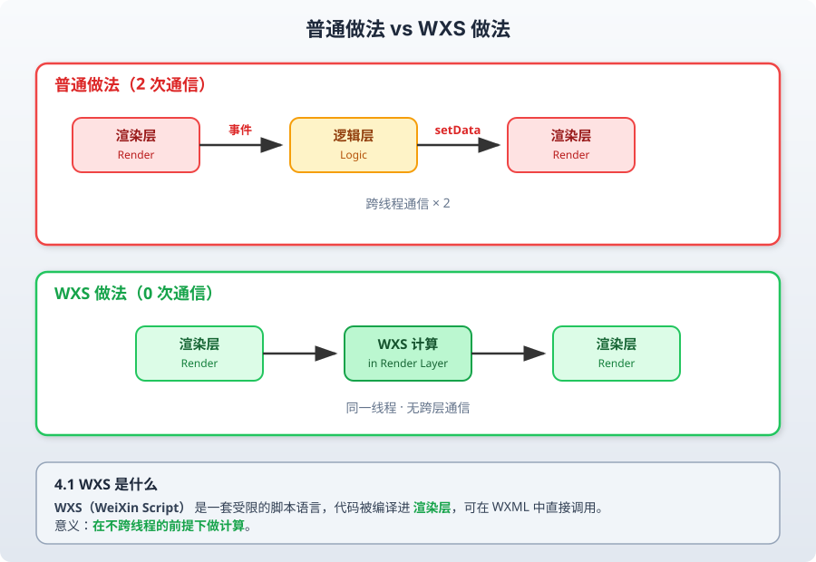

<!-- _class: cover_a -->
<!-- _paginate: "" -->
<!-- _footer: "" -->

# 第二章 渲染层深入：WXML、WXS 与 Skyline


###### “工欲善其事，必先利其器。”

张丽，井明
数据科学与计算机学院
jingming@sdu.edu.cn
2026年秋

---

<!-- _header: 目录<br>CONTENTS-->
<!-- _class: toc_b -->
<!-- _footer: "" -->
<!-- _paginate: "" -->

- WXML 的编译模型
- 列表渲染与 key 的真相
- 模板复用：template 与 include
- WXS：跑在渲染层的脚本
- 事件系统与手势
- Skyline 渲染引擎

---

<!-- _class: trans -->
<!-- _paginate: "" -->
<!-- _footer: "" -->

## 第一节 WXML 的编译模型

---

## 1.1 WXML 不是 HTML

编译器把 WXML 转成一个**生成虚拟节点树的 JS 函数**，大致等价于：

<!-- _class: smalltext -->

```html
<view class="row {{active ? 'on' : ''}}">
  <text>{{user.name}}</text>
</view>
```

```js
// 伪代码：编译产物
function render($) {
  return h('view', { class: 'row ' + ($.active ? 'on' : '') }, [
    h('text', null, [ $.user && $.user.name ])
  ])
}
```

因此 WXML 的表达式必须能被**静态分析**：可以做三元、取属性、算术、比较，
**不能**调用任意函数、不能 `new`、不能写语句块。

---

## 1.2 表达式能力边界

<!-- _class: smalltext -->

```html
<!-- ✓ 支持 -->
<view hidden="{{ !show }}">{{ a + b }}</view>
<view class="{{ level > 3 ? 'high' : 'low' }}"></view>
<view data-info="{{ {id: item.id, from: 'list'} }}"></view>
<view wx:if="{{ list.length && list[0].ok }}"></view>

<!-- ✗ 不支持 -->
<view>{{ formatPrice(item.price) }}</view>      <!-- 不能调用 JS 函数 -->
<view>{{ new Date().getTime() }}</view>
<view>{{ list.filter(x => x.ok).length }}</view>
```

三种解法：

1. 在逻辑层预处理好再 `setData`（**默认选择**）；
2. 用 **WXS**（本章第四节）；
3. 用组件的 `observers` 派生字段（第三章）。

---

## 1.3 花括号的三个坑

<!-- _class: smalltext -->

```html
<!-- 坑 1：字符串拼接必须留在花括号外 -->
<view class="item {{active ? 'on' : ''}}"></view>   <!-- ✓ -->
<view class="{{'item ' + (active ? 'on' : '')}}"></view>  <!-- ✓ 但可读性差 -->

<!-- 坑 2：布尔属性写死字符串永远为真 -->
<checkbox checked="false" />        <!-- ✗ 字符串 "false" 是 truthy -->
<checkbox checked="{{false}}" />    <!-- ✓ -->

<!-- 坑 3：对象展开与合并 -->
<template is="row" data="{{...item, index: idx}}" />   <!-- ✓ 展开语法 -->
<template is="row" data="{{item, idx}}" />             <!-- 等价 {item: item, idx: idx} -->
```

---

## 1.4 条件渲染：wx:if vs hidden

| | `wx:if` | `hidden` |
|---|---|---|
| 机制 | 条件为假时**不创建**节点 | 节点始终存在，加 `display:none` |
| 首次渲染成本 | 低 | 高（全部创建） |
| 切换成本 | 高（销毁/重建，组件生命周期重跑） | 低（改一个样式） |
| 组件状态 | 切换后**丢失** | 保留 |

<br>

**选择规则**：
- 一次性判断、分支互斥且很少切 → `wx:if`
- 频繁来回切换（Tab、折叠面板）→ `hidden`
- 分支代价大且不常出现（弹窗、长表单）→ `wx:if` + 懒加载

---

## 1.5 block 与多节点分支

```html
<!-- block 不生成真实节点，只承载指令 -->
<block wx:if="{{ status === 'loading' }}">
  <skeleton />
</block>
<block wx:elif="{{ list.length === 0 }}">
  <empty text="暂无数据" />
</block>
<block wx:else>
  <view wx:for="{{list}}" wx:key="id">{{item.title}}</view>
</block>
```

用 `<view wx:if>` 会**多出一层容器**，影响 flex 布局；`<block>` 不会。

> 规范：只要分支里包含多个同级节点，一律用 `<block>`。

---

<!-- _class: trans -->
<!-- _paginate: "" -->
<!-- _footer: "" -->

## 第二节 列表渲染与 key

---

## 2.1 wx:for 的完整写法

```html
<view wx:for="{{list}}"
      wx:for-item="row"
      wx:for-index="idx"
      wx:key="id">
  {{idx}} - {{row.title}}
</view>
```

嵌套时**必须**重命名，否则内层的 `item` 会覆盖外层：

```html
<view wx:for="{{groups}}" wx:for-item="g" wx:key="gid">
  <view wx:for="{{g.items}}" wx:for-item="it" wx:key="id">{{g.name}} / {{it.name}}</view>
</view>
```

---

## 2.2 key 到底在做什么

Exparser 更新列表时要判断"新旧两棵子树哪些节点可以复用"。

<!-- _class: smalltext -->

```text
旧: [A(id=1), B(id=2), C(id=3)]
新: [C(id=3), A(id=1), B(id=2)]

无 key（按下标比对）：
  位置0: A→C 更新内容, 位置1: B→A 更新内容, 位置2: C→B 更新内容   → 3 次全量更新
有 key（按 id 比对）：
  仅移动节点，内容不变                                             → 0 次内容更新
```

<br>

**后果不只是性能**：无 `key` 时，节点里的 `input` 值、`video` 播放进度、
自定义组件的内部 `data` 会**错位到别的行**上。

---

## 2.3 key 的三种写法与选择

```html
<!-- ① 属性名（推荐）：值必须是 string/number 且唯一稳定 -->
<view wx:for="{{list}}" wx:key="id">

<!-- ② *this：item 本身就是唯一字符串/数字时 -->
<view wx:for="{{['北京','上海','广州']}}" wx:key="*this">

<!-- ③ 不写（仅当列表永不重排、不增删） -->
<view wx:for="{{staticTabs}}">
```

**反面教材**：

```html
<view wx:for="{{list}}" wx:key="index">   <!-- 等于没有 key -->
<view wx:for="{{list}}" wx:key="{{item.id}}">  <!-- ✗ key 不需要花括号 -->
```

---

## 2.4 长列表的三层优化

<!-- _class: smalltext -->

**第一层：减少字段** —— 只把渲染要用的字段 `setData` 过去。

**第二层：增量追加** —— 分页时用数据路径拼接，不要整表重传。

```js
const start = this.data.list.length
const patch = {}
newItems.forEach((it, i) => { patch[`list[${start + i}]`] = it })
this.setData(patch)
```

**第三层：虚拟列表** —— 只渲染可视区 + 缓冲区，用 `IntersectionObserver` 或
`scroll-view` 的 `scrolltolower` 驱动，配合占位撑高滚动条。第九章会完整实现。

---

## 2.5 recycle-view（官方回收组件）

```bash
npm i miniprogram-recycle-view
```

```html
<recycle-view batch="{{batchSetRecycleData}}" id="recycleId" height="{{height}}">
  <recycle-item wx:for="{{recycleList}}" wx:key="id">
    <view class="row">{{item.title}}</view>
  </recycle-item>
</recycle-view>
```

它把不可见的节点**从树上移除**并复用节点池，适合万级列表。
代价：item 高度需要可计算，动态高度需自己提供测量函数。

---

<!-- _class: trans -->
<!-- _paginate: "" -->
<!-- _footer: "" -->

## 第三节 模板复用

---

## 3.1 template：结构复用

<!-- _class: smalltext -->

```html
<!-- templates/item.wxml -->
<template name="goods-row">
  <view class="row">
    <image src="{{cover}}" mode="aspectFill" />
    <view class="title">{{title}}</view>
    <view class="price">￥{{price}}</view>
  </view>
</template>
```

```html
<!-- pages/list/list.wxml -->
<import src="../../templates/item.wxml" />
<block wx:for="{{list}}" wx:key="id">
  <template is="goods-row" data="{{...item}}" />
</block>
```

`template` **只有结构**，没有自己的 JS 与生命周期，
数据全靠 `data` 传入 —— 轻量，但也没法封装行为。

---

## 3.2 import vs include

<!-- _class: cols-2 -->

<div class="ldiv">

**`<import>`**

- 只引入目标文件里的 `<template>` 定义
- **不递归**：A import B，B import C，
  A 拿不到 C 的模板
- 用于共享 template 库

</div>

<div class="rdiv">

**`<include>`**

- 把目标文件除 `<template>`/`<wxs>` 外的
  **整段内容**拷贝进来
- 常用于抽公共头尾

```html
<include src="../common/header.wxml" />
<view>正文</view>
<include src="../common/footer.wxml" />
```

</div>

---

## 3.3 template 还是自定义组件？

| 维度 | `template` | 自定义组件 |
|---|---|---|
| 私有数据 | ✗ | ✓ |
| 生命周期 | ✗ | ✓ |
| 事件处理 | 由使用方页面处理 | 组件内部处理，`triggerEvent` 外抛 |
| 样式隔离 | ✗（共享页面样式） | ✓ |
| 渲染开销 | 更低 | 略高（多一层 Exparser 节点） |

<br>

**经验规则**：
纯展示、无交互、在同一页面内重复 → `template`；
其余一律用**自定义组件**（第三章）。

---

<!-- _class: trans -->
<!-- _paginate: "" -->
<!-- _footer: "" -->

## 第四节 WXS：跑在渲染层的脚本

---

<!-- _footer: "" -->



---

## 4.2 基本用法：格式化

<!-- _class: smalltext -->

```html
<!-- pages/list/list.wxml -->
<wxs module="fmt">
  function price(v) {
    if (v === null || v === undefined) return '--'
    return '￥' + (v / 100).toFixed(2)
  }
  function ellipsis(s, n) {
    if (!s) return ''
    return s.length > n ? s.substring(0, n) + '…' : s
  }
  module.exports = { price: price, ellipsis: ellipsis }
</wxs>

<view wx:for="{{list}}" wx:key="id">
  <text>{{ fmt.ellipsis(item.title, 12) }}</text>
  <text>{{ fmt.price(item.priceInCent) }}</text>
</view>
```

也可抽成 `.wxs` 文件：`<wxs src="../../utils/fmt.wxs" module="fmt" />`

---

## 4.3 WXS 的语言限制

<!-- _class: smalltext -->

```js
// ✗ 不支持 ES6+
const a = 1              // 只能用 var
const f = () => {}       // 只能用 function
`模板字符串`              // 不支持
class A {}               // 不支持
[...arr]                 // 不支持展开
obj?.a                   // 不支持可选链

// ✗ 不能访问
console.log()            // 部分版本可用，不保证
Date                     // 用 getDate()（WXS 内置）
JSON                     // 用 JSON.stringify —— WXS 里不可用
wx.xxx                   // 完全不可用

// ✓ 内置对象
Math, Number, String, Array, Object（部分方法）, RegExp, getDate(), getRegExp()
```

**结论**：WXS 只写**纯粹的、短小的、无副作用的**计算。

---

## 4.4 WXS 响应事件：不经过逻辑层的交互

<!-- _class: smalltext -->

拖拽、跟手动画这类高频交互，走逻辑层必然掉帧。WXS 可以直接改渲染层样式。

```js
// utils/drag.wxs
function touchstart(e, ins) {
  var st = ins.getState()
  st.startX = e.touches[0].pageX
  st.origin = st.x || 0
  return false          // 阻止事件继续冒泡到逻辑层
}
function touchmove(e, ins) {
  var st = ins.getState()
  var dx = e.touches[0].pageX - st.startX
  st.x = Math.max(-160, Math.min(0, st.origin + dx))
  ins.selectComponent('.slider').setStyle({
    transform: 'translateX(' + st.x + 'px)'
  })
  return false
}
module.exports = { touchstart: touchstart, touchmove: touchmove }
```

---

## 4.5 绑定 WXS 事件

```html
<wxs src="../../utils/drag.wxs" module="drag" />

<view class="cell"
      bindtouchstart="{{drag.touchstart}}"
      bindtouchmove="{{drag.touchmove}}"
      bindtouchend="{{drag.touchend}}">
  <view class="slider">左滑删除</view>
  <view class="action">删除</view>
</view>
```

---

关键 API：

| API | 作用 |
|---|---|
| `ins.getState()` | 拿到与该节点绑定的持久化状态对象 |
| `ins.selectComponent(sel)` | 在渲染层选节点（同步！） |
| `.setStyle({}) / .setClass()` | 直接改样式，不走 setData |
| `ins.callMethod('fn', arg)` | **需要**通知逻辑层时才调用 |

---

## 4.6 WXS 的适用与不适用

<!-- _class: cols-2 -->

<div class="ldiv">

**适合**

- 金额/日期/单位格式化
- 文本截断、高亮分词
- 条件类名计算
- 拖拽、下拉刷新、跟手动画
- 滚动驱动的视差效果

</div>

<div class="rdiv">

**不适合**

- 任何需要网络/存储的逻辑
- 复杂业务规则（难测试、难调试）
- 需要在多页面共享的核心算法
- 会产生副作用的代码

</div>

<br>

> WXS 代码**无法打断点**，只能靠 `ins.callMethod` 把值抛回逻辑层打印。
> 因此务必写得短、纯、可推理。

---

<!-- _class: trans -->
<!-- _paginate: "" -->
<!-- _footer: "" -->

## 第五节 事件系统

---

## 5.1 绑定方式

| 前缀 | 阶段 | 冒泡 |
|---|---|---|
| `bind:tap` / `bindtap` | 冒泡阶段 | 继续冒泡 |
| `catch:tap` / `catchtap` | 冒泡阶段 | **阻止**冒泡 |
| `capture-bind:tap` | 捕获阶段 | 继续 |
| `capture-catch:tap` | 捕获阶段 | 阻止**后续捕获与冒泡** |
| `mut-bind:tap` | 冒泡阶段 | 互斥：同一事件只触发**一个** `mut-bind` |

```html
<!-- 卡片整体可点，但删除按钮不触发卡片点击 -->
<view bindtap="openDetail">
  <view catchtap="remove" data-id="{{item.id}}">删除</view>
</view>
```

---

## 5.2 事件对象

<!-- _class: smalltext -->

```js
onTap(e) {
  e.type          // 'tap'
  e.timeStamp
  e.target        // 触发事件的源节点
  e.currentTarget // 绑定事件的节点  ← 大多数时候你要的是这个
  e.detail        // 组件抛出的自定义数据 / tap 的 { x, y }
  e.touches       // 触摸点数组
  e.mark          // 从当前节点向上收集的所有 mark:xxx
}
```

```html
<view bindtap="onTap" data-id="1">
  <text>点这里 target 是 text，currentTarget 是 view</text>
</view>
```

**踩坑**：`e.target.dataset.id` 在点到子节点时是 `undefined`，
用 `e.currentTarget.dataset.id`。

---

## 5.3 dataset 的坑

```html
<view data-user-id="{{id}}" data-Item="{{it}}"></view>
```

```js
e.currentTarget.dataset
// { userId: 1, item: {...} }   ← 连字符转驼峰，大写全部转小写
```

<br>

- `data-*` 的值也要**序列化**跨线程，传大对象同样有成本；
- 更推荐传 `id` / `index`，在逻辑层反查数据；
- 需要跨多层节点取标记时，用 `mark:xxx` 比 `data-*` 更方便（会自动向上收集）。

---

## 5.4 mark 的用法

```html
<view mark:module="goods-list">
  <view wx:for="{{list}}" wx:key="id" mark:id="{{item.id}}" bindtap="onTap">
    <text mark:area="title">{{item.title}}</text>
  </view>
</view>
```

```js
onTap(e) {
  console.log(e.mark)  // { module: 'goods-list', id: 12, area: 'title' }
}
```

`mark` 从**事件源节点**一路向上收集到绑定节点，
非常适合做**统一埋点**：一个 `bindtap` 就能拿到完整上下文。

---

### mark 和 dataset 对比

对比项|data-|mark
|---|---|---|
主要用途|存储组件自定义数据|传递事件标记数据
读取方式|e.currentTarget.dataset|e.mark
支持事件冒泡传递|不能像 mark 一样合并冒泡路径上的标记数据|支持
典型用途|点击列表项获取该项 ID|在事件冒泡过程中传递父子组件的标记信息

<br>

```js
// 获取 data- 数据
e.currentTarget.dataset.userId
// 获取 mark 数据
e.mark.userId
```
简单来说：data- 主要用于给组件绑定数据，mark 主要用于给事件添加标记数据，并在事件冒泡过程中传递这些数据。


---

## 5.5 手势与触摸

```js
// 简易滑动方向判断（逻辑层版本，低频场景够用）
onTouchStart(e) {
  const t = e.touches[0]
  this._sx = t.clientX; this._sy = t.clientY; this._st = Date.now()
},
onTouchEnd(e) {
  const t = e.changedTouches[0]
  const dx = t.clientX - this._sx, dy = t.clientY - this._sy
  const dt = Date.now() - this._st
  if (dt > 500 || Math.hypot(dx, dy) < 30) return
  const dir = Math.abs(dx) > Math.abs(dy)
    ? (dx > 0 ? 'right' : 'left')
    : (dy > 0 ? 'down' : 'up')
  this.triggerEvent('swipe', { dir })
}
```

高频跟手场景请改用 **WXS 响应事件**或 **Skyline 手势组件**。

---

<!-- _class: trans -->
<!-- _paginate: "" -->
<!-- _footer: "" -->

## 第六节 Skyline 渲染引擎

---

## 6.1 为什么要换掉 WebView

WebView 渲染的固有问题：

- 启动要初始化整个浏览器内核，内存占用高；
- CSS 布局能力强但**开销大**，复杂页面 Layout 抖动明显；
- 动画依赖 CSS/JS，难以保证 60fps；
- 每个页面一个 WebView 实例，多页面内存线性增长。

<br>

**Skyline** 是微信自研的渲染引擎：自绘 UI，去掉 WebView，
布局、绘制、动画都在原生层完成，逻辑层依然是同一套 JS。

---

## 6.2 开启 Skyline

```json
// app.json
{
  "renderer": "skyline",
  "rendererOptions": {
    "skyline": { "defaultDisplayBlock": true, "disableABTest": true, "sdkVersionBegin": "3.0.0" }
  },
  "componentFramework": "glass-easel",
  "lazyCodeLoading": "requiredComponents"
}
```

也可按页面开启：

```json
// pages/feed/feed.json
{ "renderer": "skyline", "componentFramework": "glass-easel" }
```

> **glass-easel** 是 Exparser 的重写版，是 Skyline 的组件框架前提。

---

## 6.3 Skyline 的行为差异

<!-- _class: smalltext -->

| 对比项 | WebView | Skyline |
|---|---|---|
| 默认 `display` | `inline`（view 是 block） | **`flex`**，`flex-direction: column` |
| 布局模型 | 完整 CSS | 精简子集：flex 为主，**不支持 float、grid、部分选择器** |
| 长度单位 | px/rpx/em/%/vw... | px/rpx/%，部分单位不支持 |
| 滚动 | `scroll-view` 或页面滚动 | 页面**必须**用 `scroll-view`（`"navigationStyle": "custom"` 常配套） |
| 动画 | CSS animation | **Worklet 动画**，跑在 UI 线程 |
| 选择器 | 大部分支持 | 不支持后代选择器的复杂组合、伪元素受限 |

<br>

**迁移不是加一行配置**，需要重写布局。建议**新页面用 Skyline，老页面保留 WebView**——
小程序支持**逐页面**指定 renderer。

---

<!-- _footer: "" -->

## 6.4 Worklet 动画

```js
import { shared, useSharedValue } from './worklet'   // 基础库提供

Component({
  lifetimes: {
    attached() {
      this.offset = wx.worklet.shared(0)
      this.applyAnimatedStyle('.card', () => {
        'worklet'
        return { transform: `translateY(${this.offset.value}px)` }
      })
    }
  },
  methods: {
    onDrag(e) {
      'worklet'                        // 该函数编译到 UI 线程执行
      this.offset.value = e.deltaY     // 直接驱动样式，无跨线程
    }
  }
})
```

---

`'worklet'` 指令标记的函数运行在 **UI 线程**，
不经过逻辑层 → 动画在逻辑层繁忙时**依然流畅**。

---

## 6.5 Skyline 专属组件

| 组件 | 用途 |
|---|---|
| `<grid-view>` | 高性能瀑布流 / 网格，内置节点回收 |
| `<sticky-section>` / `<sticky-header>` | 吸顶分组 |
| `<span>` | Skyline 下的行内文本（`text` 内嵌套） |
| `<share-element>` | 页面间共享元素转场动画 |
| `<snapshot>` | 把节点树截图为图片 |
| `<open-container>` | 容器展开转场 |

<br>

这些组件在 WebView 下**不可用**，因此组件库要做双渲染适配时，
需要用 `wx.getRendererUserAgent()` 或构建期分包区分。

---

## 6.6 该不该上 Skyline

<!-- _class: cols-2 -->

<div class="ldiv">

**建议使用**

- 长列表 / 信息流为主的页面
- 需要复杂手势、转场动画
- 对内存与启动敏感的大型小程序
- 新建项目，可从零按 flex 设计

</div>

<div class="rdiv">

**暂缓使用**

- 重度依赖第三方 WebView 组件库
- 大量存量 CSS（float、grid、绝对定位堆叠）
- 需要兼容较低基础库版本
- 页面里有 `web-view`、复杂表单

</div>

<br>

**做法**：先挑 1–2 个高价值页面试点，用真机对比 FPS 与内存，再决定是否推广。

---

## 本章小结

<!-- _class: smalltext -->

1. WXML 被编译成**生成虚拟树的函数**，所以表达式能力受限——格式化要么放逻辑层，要么放 WXS；
2. `wx:key` 决定节点复用，缺失时不仅慢，还会导致**输入框/播放器状态错位**；
3. `template` 用于纯结构复用，有行为就上自定义组件；
4. **WXS** 让计算留在渲染层，`bind{event}="{{wxs.fn}}"` 可实现零跨线程的跟手交互；
5. 事件用 `currentTarget`，跨层上下文用 `mark`，冒泡用 `catch` / `mut-bind` 控制；
6. **Skyline** 用自绘替代 WebView，默认 flex、Worklet 动画，可**按页面**灰度启用。

---

## 思考题

1. 为什么 WXML 不能直接调用逻辑层的函数？如果允许了，双线程模型会被破坏在哪一点？
2. `wx:key="index"` 与不写 `key` 有区别吗？在"列表头部插入一条"时分别会发生什么？
3. WXS 的 `getState()` 状态存在哪里？页面 `onUnload` 后它还在吗？
4. 用 WXS 实现左滑删除，与用逻辑层 `touchmove` + `setData` 实现，在中端机上 FPS 差多少？请实测。
5. 一个已有 40 个页面的 WebView 项目要迁 Skyline，你会怎么排优先级？给出评估维度。


