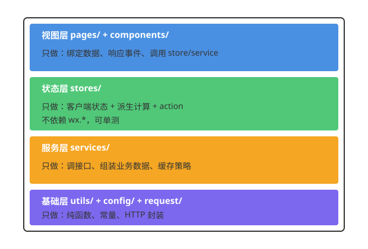

<!-- _class: cover_e -->
<!-- _paginate: "" -->
<!-- _footer:  -->
<!-- _header:  -->

# 第五章 状态管理与数据流设计

###### “流水不腐，户枢不蠹。”

张丽，井明
数据科学与计算机学院
jingming@sdu.edu.cn
2026年秋

---

<!-- _header: 目录<br>CONTENTS<br>-->
<!-- _class: toc_b -->
<!-- _footer: "" -->
<!-- _paginate: "" -->

- 状态的分层
- globalData 与它的问题
- EventBus 模式
- MobX 状态管理
- Store 的设计
- 分层架构总结

---

<!-- _class: trans -->
<!-- _paginate: "" -->

## 第一节 状态的分层

---

## 1.1 状态到底有几种

<!-- _class: smalltext -->

| 层级 | 例子 | 存放位置 | 生命周期 |
|---|---|---|---|
| **组件局部** | 下拉是否展开、输入框焦点 | 组件 `data` | 组件销毁即消失 |
| **页面局部** | 列表数据、当前分页、筛选条件 | 页面 `data` | 页面出栈即消失 |
| **跨页面共享** | 购物车、用户信息、主题 | **Store** | App 生命周期 |
| **持久化** | 登录 token、搜索历史、草稿 | `Storage` | 卸载/清缓存才消失 |
| **服务端** | 订单、商品 | 后端 | 权威数据源 |

<br>

**90% 的状态管理事故**，都源于把状态放错了层：
把页面局部状态塞进全局 Store，或者把服务端数据当成客户端状态长期缓存。

---

## 1.2 判断标准

问三个问题：

1. **谁读它？** 只有一个组件 → 组件 `data`；一个页面内多个组件 → 页面 `data` 下发；
   多个页面 → Store。
2. **谁写它？** 只有拥有者写 → 局部；多方写 → Store（需要明确的 action）。
3. **它需要活多久？** 页面关掉就没用 → 局部；下次启动还要用 → Storage。

<br>

> **默认放最低层**，只有当明确需要跨层共享时才上升一层。
> "以后可能会用到"不是理由。

---

## 1.3 服务端状态 ≠ 客户端状态

```js
// ✗ 把接口数据当全局状态长期持有
store.goodsList = res.data     // 什么时候失效？谁负责刷新？

// ✓ 服务端状态属于"缓存"，要有失效策略
const cache = new TTLCache({ ttl: 60_000 })
async function getGoods(id) {
  return cache.get(id) ?? cache.set(id, await api.goods(id))
}
```

<br>

真正应该进 Store 的是**客户端自己产生的状态**：
购物车勾选项、筛选条件、草稿、主题、登录态。

服务端数据用**带失效的缓存层**管理（第六章）。

---

## 第一节关键知识点讲解

<!-- _class: smalltext -->

### 先确定状态的所有者，再决定存放位置

状态不是“变量放在哪里”的单纯问题，而是要同时考虑**谁负责读写**、**哪些界面需要同步**以及**状态要保留多久**。例如，弹窗是否打开只影响当前组件，应放组件 `data`；搜索页的筛选条件只在当前页面流程中使用，放页面 `data`；购物车被商品页、购物车页等多个页面共同读写，适合放在 Store。

把状态放在最低且足够的层级，可以减少不必要的共享和同步工作。组件或页面独占的数据无需提升为全局状态；反过来，多个页面共同使用的数据若各自维护副本，就容易出现显示不一致。

---

### 共享范围与生命周期是两条不同的轴

“多个页面会用”说明它需要共享，但不代表它必须永久保存；“下次启动还要用”说明需要持久化，也不代表它必须成为全局 Store。Store 通常负责当前运行期间的共享状态，Storage 负责跨启动保存。需要两者兼顾时，应由明确的持久化逻辑把 Store 中选定的数据同步到 Storage，并考虑恢复、更新和清理时机。

---

### 区分客户端状态与服务端数据

购物车勾选、主题选择等由客户端交互产生或控制的数据，适合作为客户端状态管理。商品详情、订单列表等接口返回的数据，其权威来源仍是服务端；客户端可以缓存它们以减少请求，但缓存必须有刷新或失效策略。否则页面可能长期展示过期数据，也难以说明何时重新请求。

**记忆方法：** 先问“谁需要它”，再问“它活多久”，最后确认“谁是权威来源”。答案分别帮助选择组件/页面/Store、运行期/持久化，以及客户端状态/服务端缓存。

---

## 第一节选择题

<!-- _class: smalltext -->

### 1. 弹窗的展开状态只由一个组件使用，最合适放在哪里？

A. 全局 Store　　B. 组件 `data`　　C. Storage　　D. 服务端

**答案：B。解析：** 状态只有当前组件需要，组件 `data` 是足够且生命周期合适的最低层级；放入全局 Store 或 Storage 会增加无用的共享与维护。

---

### 2. 搜索历史需要在用户下次启动小程序时继续显示，关键是使用哪种存储？

A. 组件 `data`　　B. 页面 `data`　　C. Storage　　D. EventBus

**答案：C。解析：** 组件和页面数据会随界面生命周期结束而消失；Storage 用于跨启动保留数据。是否同时放入 Store，要看运行期间是否有多个页面共享它。


---

### 3. 商品详情由接口返回，客户端希望减少重复请求，哪种做法更合理？

A. 当作永不过期的全局状态　　B. 只放在组件 `data`，不再刷新

C. 使用有明确失效或刷新的缓存　　D. 每次收到事件时覆盖所有页面数据

**答案：C。解析：** 商品详情的权威来源是服务端。缓存可以提升体验，但需要 TTL、主动刷新或其他失效策略，避免客户端长期持有过期副本。

---

<!-- _class: trans -->
<!-- _paginate: "" -->

## 第二节 globalData 与它的问题

---

## 2.1 最朴素的方案

```js
// app.js
App({
  globalData: { userInfo: null, cart: [] }
})
```

```js
// 任意页面
const app = getApp()
app.globalData.cart.push(item)
this.setData({ cart: app.globalData.cart })
```

<br>

**它能用**，小项目里完全够。但随着规模增长会暴露三个问题。

---

## 2.2 问题一：没有响应式

```js
// A 页面改了
app.globalData.cart.push(item)

// B 页面完全不知道，界面还是旧的
// 只能在 onShow 里手动重新读一遍
onShow() { this.setData({ cart: getApp().globalData.cart }) }
```

<br>

于是每个页面都要写 `onShow` 同步代码。
一旦忘了写，就是"返回上一页数据没更新"的经典 Bug。

---

## 2.3 问题二：没有约束

```js
// 任何地方都能改，改错了无从追溯
app.globalData.userInfo = null          // 谁把它清空的？
app.globalData.cart[0].qty = -1         // 谁允许负数的？
app.globalData.cart = undefined         // 类型都变了
```

<br>

没有 action 层，就没有：

- 修改的**唯一入口**（无法打日志、无法校验）
- 修改的**原子性**（改到一半出错，状态不一致）
- 修改的**可测试性**

---

## 2.4 问题三：getApp() 的时序陷阱

```js
// components/header/header.js
const app = getApp()          // ✗ 组件文件被 require 时 App() 可能还没执行完
Component({
  data: { user: app.globalData.userInfo }   // 可能是 undefined
})
```

正确写法：

```js
Component({
  lifetimes: {
    attached() {
      const app = getApp()    // ✓ 在生命周期里取
      this.setData({ user: app.globalData.userInfo })
    }
  }
})
```

<br>

同样地，**分包**里的代码在主包 `App()` 之前不会执行，但工具类模块的顶层代码会。

---

## 2.5 什么时候 globalData 够用

<!-- _class: cols-2 -->

<div class="ldiv">

**够用**

- 只读的启动参数（场景值、渠道）
- 全局配置（环境、AppID）
- 生命周期内不变的设备信息

</div>

<div class="rdiv">

**不够用**

- 会变且多页面要感知的（购物车、登录态）
- 需要派生计算的（总价、勾选数）
- 需要持久化同步的

</div>

<br>

**结论**：`globalData` 存**常量**，变量交给 Store。

---

## 第二节关键知识点讲解

<!-- _class: smalltext -->

### `globalData` 是共享容器，不是响应式状态管理

`App({ globalData })` 提供了一个便于全局访问的普通对象。页面通过 `getApp()` 读写它，但对对象属性或数组的修改不会自动通知其他页面，也不会自动调用页面的 `setData`。因此，修改共享数据和刷新视图是两件事：修改方必须显式通知或更新界面，其他页面也要在合适时机重新读取。

---

### 直接读写会让修改入口分散

当每个页面都能直接修改 `globalData`，就很难确定谁在何时改变了数据，也难以统一检查业务规则。例如购物车数量应限制在合理范围、退出登录时用户信息应清理。将变化集中到 action 或明确的方法中，能够统一校验、记录和测试；否则共享对象虽只有一份，规则却散落在各处。

---

### `getApp()` 的调用时机很重要

模块顶层代码在文件加载时执行，而小程序的 App 实例及其数据初始化有自己的启动时序。在组件或工具模块顶层立即读取 `getApp().globalData`，可能拿到未就绪的数据。把读取放到 `attached` 等组件生命周期中，或页面生命周期中，可以在实例可用后再访问。模块顶层适合放函数和常量，不适合依赖 App 实例已经完成初始化的值。

---

### 用途边界：放稳定配置，不承载复杂变化

启动渠道、环境配置等生命周期内基本不变的信息适合放在 `globalData`。需要多个页面自动同步的购物车、用户状态，或需要派生总价、持久化等能力的数据，应使用具有明确更新机制的 Store。判断时可问：这个值会不会变？变化后谁要立刻知道？是否需要校验、派生或保存？

---

## 第二节选择题

<!-- _class: smalltext -->

### 1. 页面 A 执行 `getApp().globalData.cart.push(item)` 后，页面 B 的界面会怎样？

A. 一定自动刷新　　B. 一定触发 `onShow`　　C. 不会因这次修改而自动刷新　　D. 小程序会自动持久化

**答案：C。解析：** `globalData` 是普通共享对象，不具备视图响应式能力。页面 B 需要在适当时机重新读取并调用 `setData`，或使用 Store 等具备订阅更新机制的方案。

---

### 2. 多个页面都能直接修改 `globalData.cart`，最主要的维护风险是什么？

A. 无法确定和约束状态修改入口　　B. `getApp()` 每次都会创建新实例

C. 数据会自动写入 Storage　　D. 页面无法调用 `setData`

**答案：A。解析：** 任意位置直接读写会让规则和修改路径分散，难以校验数量、追踪变化和测试。集中到 action 或方法中可以形成明确入口。

---

### 3. 在组件 JS 文件顶层立即执行 `const app = getApp()` 并读取用户信息，可能有什么问题？

A. 组件的 `attached` 会被跳过　　B. 读取时 App 数据可能尚未完成初始化

C. `globalData` 会变成只读　　D. 页面会自动销毁

**答案：B。解析：** 模块顶层代码在文件加载时运行，可能早于 App 初始化完成。应在组件或页面生命周期中读取，确保实例和所需数据已就绪。

---

<!-- _class: trans -->
<!-- _paginate: "" -->

## 第三节 EventBus 模式

---

## 3.1 极简实现

<!-- _footer: '' -->

```js
// utils/event-bus.js
class EventBus {
  constructor() { this.map = new Map() }
  on(evt, fn) {
    if (!this.map.has(evt)) this.map.set(evt, new Set())
    this.map.get(evt).add(fn)
    return () => this.off(evt, fn)          // 返回取消函数
  }
  once(evt, fn) {
    const wrap = (...a) => { this.off(evt, wrap); fn(...a) }
    return this.on(evt, wrap)
  }
  off(evt, fn) {
    if (!fn) return this.map.delete(evt)
    this.map.get(evt)?.delete(fn)
  }
  emit(evt, payload) {
    // 复制一份再遍历，避免回调里 off 导致迭代异常
    ;[...(this.map.get(evt) || [])].forEach(fn => {
      try { fn(payload) } catch (e) { console.error('[bus]', evt, e) }
    })
  }
}
module.exports = new EventBus()
```

---

## 3.2 用 behavior 保证自动解绑

<!-- _footer: '' -->


```js
// behaviors/bus.js
const bus = require('../utils/event-bus')
module.exports = Behavior({
  lifetimes: {
    created() { this._offs = [] },
    detached() { this._offs.forEach(off => off()); this._offs = [] }
  },
  methods: {
    $on(evt, fn) { this._offs.push(bus.on(evt, fn.bind(this))) }
  }
})
```

```js
Component({
  behaviors: [require('../../behaviors/bus')],
  lifetimes: {
    attached() { this.$on('cart:change', cart => this.setData({ count: cart.length })) }
  }
})
```

> **忘记 `off` 是 EventBus 最大的坑**：页面销毁后回调仍持有实例引用，
> 触发时对已销毁页面 `setData`，既泄漏内存又报错。用 behavior 强制解绑。

---

## 3.3 EventBus 的适用边界

<!-- _class: cols-2 -->

<div class="ldiv">

**适合**

- 一次性通知：
  "登录成功了"、"支付完成了"
- 跨页面回传：
  地址选择页 → 订单页
- 全局广播：
  网络恢复、主题切换

</div>

<div class="rdiv">

**不适合**

- 承载**状态**本身
  （事件是瞬时的，后订阅者收不到）
- 复杂的数据依赖
  （A 依赖 B 依赖 C，事件链难追踪）
- 需要"当前值"的场景

</div>

<br>

**判据**：如果接收方需要问"现在的值是多少"，那就该用 Store 而不是事件。

---

## 3.4 官方的跨页面通信 API

<!-- _footer: '' -->


```js
// 打开页面时约定通道
wx.navigateTo({
  url: '/pages/address/select',
  events: {
    // 监听被打开页面发来的事件
    selected(data) { this.setData({ address: data }) }
  },
  success(res) {
    // 向被打开页面发送数据
    res.eventChannel.emit('init', { current: this.data.address })
  }
})
```

---

```js
// pages/address/select.js
onLoad() {
  const ch = this.getOpenerEventChannel()
  ch.on('init', d => this.setData({ current: d.current }))
  this._ch = ch
},
pick(item) { this._ch.emit('selected', item); wx.navigateBack() }
```

**优点**：通道是**页面对页面**的，不会污染全局，页面销毁自动失效。

---

<!-- _footer: '' -->


## 第三节关键知识点讲解

<!-- _class: smalltext -->

### EventBus 传递的是“发生了什么”

EventBus 由事件名和回调组成：订阅者用 `on` 注册处理函数，发布者用 `emit` 发出事件及载荷。它让发送方不必直接持有接收方实例，适合登录成功、支付完成、网络恢复等通知。事件是瞬时的：若事件发出时没人订阅，之后订阅的页面不会自动收到过去的载荷。因此需要随时查询的当前状态应存放在 Store，而不是只靠事件保存。

---

### 订阅生命周期必须和页面生命周期配对

订阅回调可能持有页面或组件实例。若页面销毁后仍未取消订阅，事件再次触发时可能对已销毁实例调用 `setData`，同时让实例无法释放。`on` 返回取消函数，使用者应在页面或组件销毁时调用；示例中的 behavior 把取消函数集中保存，并在 `detached` 时逐一执行，减少遗漏。

---

### 事件名和载荷是模块间契约

事件名应表达明确的业务事实，如 `cart:change`；载荷结构应稳定且有约定，例如 `{ items, count }`。如果发布端和订阅端各自猜字段名，改动就容易造成静默错误。调试时也应能从事件名与载荷快速看出谁发布了什么、哪些订阅者会响应。

---

### 选 EventBus 还是 `eventChannel`

`eventChannel` 适合由一个页面打开另一个页面时进行有明确起点和终点的双向通信，例如地址选择页把选中的地址返回订单页。通道只属于这次页面关系，页面结束后自动失效。EventBus 面向更广范围的广播或多个订阅者；若接收者只需获取当前值，优先 Store。选择时看通信范围、是否需要广播，以及消息是否代表状态还是一次事件。

---

## 第三节选择题

<!-- _class: smalltext -->

### 1. 某页面订阅了 `cart:change`，页面销毁后没有取消订阅。最可能的后果是什么？

A. 事件自动保存到 Storage　　B. 回调仍引用页面实例，触发时可能对已销毁页面调用 `setData`

C. EventBus 自动重建页面　　D. 其他事件都无法发布

**答案：B。解析：** 订阅回调会被 EventBus 持有，若不解绑，页面实例可能持续被引用；后续事件触发时还可能对已销毁页面执行更新。应在销毁生命周期调用取消函数。

---

### 2. 一个页面需要在任何时候读取“当前购物车总价”，最合适的方案是什么？

A. 只通过 EventBus 广播总价　　B. 用 Store 保存状态并提供派生总价

C. 每次页面加载时监听一次事件　　D. 把事件名改成 `cart:current-total`


**答案：B。解析：** EventBus 是瞬时通知机制，晚订阅者可能错过事件；当前值及其派生计算属于状态管理问题，Store 可以持续提供最新状态。

---

### 3. 地址选择页由订单页通过 `navigateTo` 打开，选好地址后返回结果，优先考虑哪种方式？

A. `eventChannel`　　B. `globalData`　　C. `setInterval` 轮询　　D. Storage

**答案：A。解析：** 这是有明确页面发起方和返回方的一次性通信，`eventChannel` 作用域限定在这组页面之间，页面关系结束后通道也会失效。

---

<!-- _class: trans -->
<!-- _paginate: "" -->

## 第四节 MobX 状态管理

---

## 4.1 为什么选 MobX

小程序生态里主流的两个选择：

| | MobX (`mobx-miniprogram`) | Redux 风格 |
|---|---|---|
| 心智负担 | 低：改对象即触发更新 | 高：action/reducer/dispatch 样板代码 |
| 派生计算 | `computed` 自动缓存 | 需 reselect 等库 |
| 与小程序集成 | 官方维护 `mobx-miniprogram-bindings` | 需自己写 connect |
| 调试可追溯性 | 中（可加 action 日志） | 高（时间旅行） |
| 体积 | ~15KB | 视实现 |

<br>

本课程选 **MobX**：官方维护、样板少、与 `observers` 心智一致。

---

## 4.2 安装

```bash
npm i mobx-miniprogram mobx-miniprogram-bindings
```

然后**构建 npm** + 勾选**使用 npm 模块**。

<br>

两个包的分工：

- `mobx-miniprogram`：MobX 核心（`observable` / `action` / `computed` / `runInAction`）；
- `mobx-miniprogram-bindings`：把 store 绑定到 `Page` / `Component`
  （`storeBindingsBehavior` / `ComponentWithStore` / `BehaviorWithStore`）。

---

## 4.3 定义一个 Store

<!-- _footer: '' -->


```js
// stores/cart.js
import { observable, action } from 'mobx-miniprogram'

export const cartStore = observable({
  // ── 状态 ──
  items: [],                       // [{ id, title, priceInCent, qty, checked }]

  // ── 派生（getter 即 computed，自动缓存） ──
  get count() { return this.items.reduce((s, it) => s + it.qty, 0) },
  get checkedItems() { return this.items.filter(it => it.checked) },
  get totalInCent() {
    return this.checkedItems.reduce((s, it) => s + it.priceInCent * it.qty, 0)
  },
  get totalText() { return '￥' + (this.totalInCent / 100).toFixed(2) },
  get allChecked() { return this.items.length > 0 && this.items.every(it => it.checked) },

  // ── 动作 ──
  add: action(function (goods) {
    const hit = this.items.find(it => it.id === goods.id)
    if (hit) hit.qty += 1
    else this.items.push({ ...goods, qty: 1, checked: true })
  }),
  setQty: action(function (id, qty) {
    const hit = this.items.find(it => it.id === id)
    if (hit) hit.qty = Math.max(1, Math.min(99, qty))
  }),
  remove: action(function (id) { this.items = this.items.filter(it => it.id !== id) }),
  toggleAll: action(function (checked) { this.items.forEach(it => { it.checked = checked }) })
})
```

---

## 4.4 在页面里绑定

<!-- _class: smalltext -->

```js
// pages/cart/cart.js
import { ComponentWithStore } from 'mobx-miniprogram-bindings'
import { cartStore } from '../../stores/cart'

ComponentWithStore({
  storeBindings: {
    store: cartStore,
    fields: ['items', 'count', 'totalText', 'allChecked'],   // 自动 setData 到 data
    actions: ['setQty', 'remove', 'toggleAll']               // 挂到 this
  },
  methods: {
    onLoad() {},
    onStep(e) { this.setQty(e.currentTarget.dataset.id, e.detail.value) },
    onRemove(e) { this.remove(e.currentTarget.dataset.id) },
    onToggleAll() { this.toggleAll(!this.data.allChecked) }
  }
})
```

---

```html
<view wx:for="{{items}}" wx:key="id">
  <text>{{item.title}}</text>
  <stepper value="{{item.qty}}" data-id="{{item.id}}" bind:change="onStep" />
</view>
<view>共 {{count}} 件，合计 {{totalText}}</view>
```

---

<!-- _footer: '' -->


## 4.5 fields 的三种写法

```js
storeBindings: {
  store: cartStore,

  // ① 数组：同名映射
  fields: ['items', 'count'],

  // ② 对象：重命名
  fields: { cartItems: 'items', cartCount: 'count' },

  // ③ 函数：任意派生（每次 store 变化都会重算）
  fields: {
    expensive: () => cartStore.items.filter(i => i.priceInCent > 10000).length
  }
}
```

<br>

**性能提示**：`fields` 里的每个字段变化都会触发一次 `setData`。
bindings 会做批处理合并，但**不要把大数组直接绑上去**——
先在 store 的 `computed` 里裁剪成渲染需要的形状。

---

## 4.6 多 store 与 behavior 复用

```js
// 多个 store
storeBindings: [
  { store: cartStore, fields: ['count'] },
  { store: userStore, fields: ['nickname', 'isLogin'], actions: ['logout'] }
]
```

```js
// behaviors/with-user.js —— 让任意组件都能拿到用户态
import { BehaviorWithStore } from 'mobx-miniprogram-bindings'
import { userStore } from '../stores/user'

module.exports = BehaviorWithStore({
  storeBindings: { store: userStore, fields: ['isLogin', 'nickname'] }
})
```

```js
Component({ behaviors: [require('../../behaviors/with-user')] })
```

---

## 4.7 手动订阅（不在组件里时）

```js
import { autorun, reaction } from 'mobx-miniprogram'

// 状态一变就跑（含首次）
const dispose = autorun(() => {
  console.log('购物车件数', cartStore.count)
})

// 只在指定表达式变化时跑
const dispose2 = reaction(
  () => cartStore.items.length,
  len => wx.setTabBarBadge({ index: 2, text: String(len) })
)

// 记得释放
dispose(); dispose2()
```

**典型用途**：把 store 变化同步到 TabBar 角标、同步到本地缓存、上报埋点。

---

## 第四节关键知识点讲解

<!-- _class: smalltext -->

### Store 同时管理原始状态与派生状态

`observable` 把可变数据变成可观察状态，例如购物车 `items`。当界面或计算读取这些字段时，MobX 会跟踪依赖；字段变化后，依赖它们的计算和绑定会更新。像件数、勾选商品、总价这类可由原始数据推导出的值，用 getter 表达，避免手工维护多份容易互相矛盾的数据。派生值应只计算、不另行写入。

---

### `action` 是一次业务修改的边界

`action` 封装业务写操作，例如增加商品、修改数量或全选。这样调用者表达“做什么”，而不必了解内部数据结构；校验规则也能集中在 action 中。一个业务动作可能修改多个字段，集中执行有助于让状态变化保持完整，并便于日志记录和测试。页面应调用 Store 暴露的动作，不要到处直接改字段。

---

### Bindings 负责把 Store 接到小程序视图

`mobx-miniprogram-bindings` 将指定的 `fields` 同步到页面或组件的 `data`，使 WXML 能像使用普通页面数据一样渲染；`actions` 则映射为实例方法供事件处理函数调用。数组形式用于同名映射，对象形式可以重命名，函数形式可提供自定义派生值。绑定范围宜保持精简，只传递当前视图真正要展示的数据，避免大对象或大列表造成不必要的更新。

---

### 手动反应适合视图之外的副作用

组件绑定之外的工作可用 `autorun` 或 `reaction`：前者在读取到的依赖变化时重新运行，后者先观察指定表达式，只在其结果变化时运行回调。它们可用于更新 TabBar 角标、持久化或埋点，但会建立持续订阅。页面或应用不再需要时必须调用返回的 disposer，避免重复执行和资源泄漏。

---

## 第四节选择题

<!-- _class: smalltext -->

### 1. 购物车总价可以由商品价格、数量和勾选状态计算得到，最合适如何管理？

A. 每次增删商品时手工同步另一个总价字段　　B. 使用 Store 中的 getter 派生计算

C. 放入 `globalData` 并由各页面分别计算　　D. 通过 EventBus 保存总价

**答案：B。解析：** 总价是已有状态的派生结果。用 getter 计算可以避免原始数据变化后忘记同步总价所造成的不一致；MobX 会跟踪依赖并按需更新。

---

### 2. 页面点击加购后，应该如何修改 `cartStore.items`？

A. 在 WXML 里直接修改　　B. 在任意页面直接 `push`

C. 调用 Store 提供的 `add` action　　D. 把数组先写入 Storage 再读取

**答案：C。解析：** action 是集中承载业务写入和校验的入口。页面调用 `add` 表达业务意图，Store 决定如何合并同商品、设置数量等，便于追踪与测试。

---

### 3. 用 `autorun` 更新 TabBar 角标后，何时应调用它返回的函数？

A. 每次读取角标之前　　B. 页面或应用不再需要该订阅时

C. 每次状态变化之后　　D. 永远不调用

**答案：B。解析：** `autorun` 会持续跟踪依赖并在变化时重跑。调用 disposer 可以停止反应，通常在所属页面或应用生命周期结束、不再需要该副作用时释放。

---

<!-- _class: trans -->
<!-- _paginate: "" -->

## 第五节 Store 的设计

---

## 5.1 按领域拆分，不要一个大 store

```text
stores/
├── user.js       登录态、用户信息
├── cart.js       购物车
├── order.js      下单流程的临时状态
├── config.js     远程配置、开关
└── index.js      统一导出
```

<br>

判断依据：**能否独立演进**。
购物车的改动不应该导致用户模块的测试失败。

---

## 5.2 action 是唯一的写入口

```js
// ✗ 直接改，绕过 action：MobX 不报错，但你失去了追踪能力
cartStore.items.push(goods)

// ✓ 走 action
cartStore.add(goods)
```

<br>

好处：

1. 可以在 action 里统一做**校验**（数量上限、库存）；
2. 可以统一**打日志**（谁在什么时候改了什么）；
3. 一个 action 内的多次修改会**合并成一次**通知，减少 setData；
4. 便于**单元测试**：调 action，断言 computed。

---

## 5.3 异步怎么办

```js
import { observable, action, runInAction } from 'mobx-miniprogram'

export const userStore = observable({
  info: null, loading: false, error: '',

  setLoading: action(function (v) { this.loading = v }),
  setInfo: action(function (info) { this.info = info; this.error = '' }),
  setError: action(function (msg) { this.error = msg }),

  // 异步流程本身不是 action，它调用多个 action
  async fetchProfile() {
    this.setLoading(true)
    try {
      const info = await api.getProfile()
      this.setInfo(info)
    } catch (e) {
      this.setError(e.message)
    } finally {
      this.setLoading(false)
    }
  }
})
```

**注意**：`await` 之后的赋值必须在 action 或 `runInAction` 里，否则脱离了批处理。

---

## 5.4 持久化

<!-- _class: smalltext -->

```js
// stores/persist.js
import { autorun } from 'mobx-miniprogram'

export function persist(store, key, fields, { debounce = 300 } = {}) {
  // 启动时恢复
  const saved = wx.getStorageSync(key)
  if (saved) fields.forEach(f => { if (saved[f] !== undefined) store[f] = saved[f] })

  // 变化时保存（去抖，避免频繁写盘）
  let timer = null
  return autorun(() => {
    const snapshot = {}
    fields.forEach(f => { snapshot[f] = JSON.parse(JSON.stringify(store[f])) })
    clearTimeout(timer)
    timer = setTimeout(() => wx.setStorage({ key, data: snapshot }), debounce)
  })
}
```

---

```js
// app.js
persist(cartStore, 'cart', ['items'])
```

> `autorun` 里必须**访问**到字段才会被追踪——这就是要显式 `snapshot[f] = store[f]` 的原因。

---

## 5.5 Store 的单元测试

```js
// stores/__tests__/cart.test.js
import { cartStore } from '../cart'

beforeEach(() => { cartStore.items = [] })

test('add 同一商品累加数量', () => {
  cartStore.add({ id: 1, title: 'A', priceInCent: 1000 })
  cartStore.add({ id: 1, title: 'A', priceInCent: 1000 })
  expect(cartStore.items).toHaveLength(1)
  expect(cartStore.count).toBe(2)
})

test('totalText 只统计勾选项', () => {
  cartStore.add({ id: 1, title: 'A', priceInCent: 1000 })
  cartStore.add({ id: 2, title: 'B', priceInCent: 2000 })
  cartStore.items[1].checked = false
  expect(cartStore.totalText).toBe('￥10.00')
})
```

**Store 不依赖 `wx.*`，因此可以在 Node 里直接跑 Jest**——这是分层的直接收益。

---

## 第五节关键知识点讲解

<!-- _class: smalltext -->

### 按业务领域拆分 Store

用户、购物车和订单流程有不同的数据、规则与变化节奏。按领域拆分后，每个 Store 的职责更清楚，可以独立修改和测试，也能减少无关模块之间的耦合。拆分并非为了追求文件数量；如果两个状态总是由同一业务动作一起维护、生命周期也一致，可以放在同一领域模块中。若多个 Store 互相引用形成循环依赖，通常应重新划分职责或提取真正共享的领域能力。

---

### 通过 action 集中写入规则

Store 的 action 是业务状态的明确写入口。例如 `add(goods)` 可以处理重复商品合并、数量上限和库存校验，而调用页面只需表达“加入商品”。集中写入便于追踪变化来源，也让测试能围绕业务动作断言结果。将 action 作为约定入口，避免组件或页面直接修改 Store 内部字段。

---

### 异步流程要把等待前后的修改分清楚

异步请求本身不代表状态修改。开始请求时可通过 action 设置 `loading`，请求成功后通过 action 保存结果，失败时设置错误信息，最后清除加载状态。关键是 `await` 之后的代码在新的异步时段继续执行；若直接修改 observable 字段，应使用 action 或 `runInAction` 包住这段写入，确保更新边界清楚。服务调用可放在 service 层，Store 负责管理请求过程对应的客户端状态。

---

### 持久化应明确字段、恢复时机与订阅释放

持久化不是把整个 Store 无差别地存起来。应只选择需要跨启动保留的字段，并在初始化时恢复；变化时再通过订阅保存，去抖可以合并短时间内的多次写入。`autorun` 必须读取目标字段才能追踪它们，返回的 disposer 则应在持久化任务结束时调用。还应考虑数据版本变化、无效数据和用户切换时的清理策略。

---

### Store 可单测的关键是隔离平台依赖

如果 Store 只包含状态、派生值和业务 action，不直接依赖 `wx.*`、页面实例或网络 API，就能在 Node 环境验证规则。测试应覆盖边界行为和派生结果，例如重复加入是否累加、数量上下限是否生效、未勾选商品是否不计入总价。平台存储与请求适合通过 service 或注入的依赖隔离。

---

## 第五节选择题

<!-- _class: smalltext -->

### 1. 购物车和用户资料有独立规则、可以分别演进，Store 结构如何设计更合适？

A. 所有状态放进一个全局大 Store　　B. 按领域拆成 `cartStore` 和 `userStore`

C. 每个页面复制一份购物车状态　　D. 把所有状态放进 Storage

**答案：B。解析：** 按业务领域拆分能让职责、规则和测试边界更清楚，降低无关模块之间的耦合。拆分依据是能否独立演进，而不是单纯增加文件数量。

---

### 2. `fetchProfile` 在 `await api.getProfile()` 之后要更新 observable 的 `info`，应如何确保写入处于 action 边界内？

A. 直接在任何异步回调中赋值　　B. 用 action 方法或 `runInAction` 包住赋值

C. 把 `info` 改成普通局部变量　　D. 通过 `getApp()` 更新页面数据

**答案：B。解析：** `await` 后的执行发生在异步流程恢复阶段；用 action 或 `runInAction` 包住 observable 写入，可以保持状态修改边界明确并正确触发更新。

---

### 3. 为什么 Store 尽量不直接调用 `wx.*` 和页面实例方法？

A. 这样状态就无法持久化　　B. 这样 Store 更容易脱离小程序环境进行单元测试

C. `wx.*` 只能在 WXML 中调用　　D. 页面不能读取 Store

**答案：B。解析：** 平台 API 和页面实例属于运行环境依赖。把它们隔离在视图层或服务层，Store 的状态规则就可以在 Node 中独立验证，减少测试对小程序运行时的依赖。

---

<!-- _class: trans -->
<!-- _paginate: "" -->

## 第六节 分层架构总结

---

## 6.1 推荐的四层结构



依赖只能**自上而下**。`stores/` 不 import `pages/`，`utils/` 不 import 任何上层。


---

## 6.2 一次完整的数据流

<!-- _class: smalltext -->

```text
用户点击「加入购物车」
  │
  ├─ 1. 组件 triggerEvent('add', {id})
  │
  ├─ 2. 页面 onAdd(e) → 调 service
  │        const goods = await goodsService.detail(e.detail.id)
  │
  ├─ 3. service 调 request，命中缓存或发请求
  │
  ├─ 4. 页面把结果交给 store
  │        cartStore.add(goods)
  │
  ├─ 5. store 的 action 修改 items
  │        computed count / totalText 自动失效重算
  │
  ├─ 6. bindings 检测到 fields 变化 → 批量 setData
  │
  └─ 7. 所有绑定了 cartStore 的页面/组件同步更新（包括 TabBar 角标）
```

---

## 6.3 三种方案的选型

| 项目规模 | 方案 |
|---|---|
| 5 页以内，无跨页共享 | 页面 `data` + `eventChannel` |
| 10–20 页，少量共享 | `globalData`（常量）+ EventBus（通知） |
| 20 页以上，购物车/登录态/多端同步 | **MobX Store 分层** |

<br>

**不要过度设计**：三个页面的项目引入 Store，
维护成本大于收益。但**分层的目录结构**任何规模都值得从第一天就建立。

---

## 6.4 常见反模式清单

<!-- _class: smalltext -->

1. **把 UI 状态放全局**：弹窗开关、滚动位置进了 store；
2. **store 里调 `wx.request`**：状态层依赖了网络，无法单测；
3. **在组件里直接改 store 字段**：绕过 action；
4. **把整个接口响应绑到 fields**：大对象跨线程；
5. **EventBus 承载状态**：后订阅者拿不到值，只能补 `globalData` 兜底 —— 双份状态源；
6. **忘记 `off` / `dispose`**：内存泄漏 + 对已销毁页面 setData；
7. **多个 store 互相 import 形成环**：改成事件通知或提取共享 store。

---

## 第六节关键知识点讲解

<!-- _class: smalltext -->

### 分层的核心是职责清楚、依赖方向稳定

视图层负责展示数据、处理用户输入；状态层管理客户端状态、业务动作与派生计算；服务层负责请求接口、组装数据和缓存策略；基础层提供可复用的纯函数、配置与请求封装。上层可以调用下层能力，下层不应反向依赖页面或组件。这样更换页面实现或单独测试 Store 时，不必把整个小程序运行环境一起带上。

---

### 一次用户操作沿着明确的数据流完成

加入购物车时，组件把用户动作通过事件交给页面；页面根据商品 ID 调用服务层获取必要数据；页面再调用 Store 的 action 更新客户端购物车；MobX 重新计算受影响的派生值，bindings 将关心的字段同步到视图。每一步有明确责任人，问题更容易定位：接口数据问题查 service，请求后状态不对查 action，界面未刷新则检查绑定字段和视图。

---

### 方案要匹配共享范围和复杂度

没有跨页面共享的小页面，可以用页面 `data` 与 `eventChannel`；少量稳定共享信息可以放 `globalData`，一次性通知用 EventBus；当购物车、登录态等状态需要跨页面同步、派生计算和明确更新规则时，再引入 Store。项目页数只是参考，真正的判断标准是共享状态的数量、变化频率和维护复杂度，避免为了“架构完整”增加不必要的依赖。

---

### 反模式通常来自边界被打破

把弹窗开关放进全局 Store 会扩大状态范围；Store 直接调用 `wx.request` 会让状态逻辑依赖平台；页面直接改 Store 字段会绕开 action；把整个接口响应绑定到视图会增加传输和更新成本；EventBus 若被当作当前状态源，则新订阅者无法获得已有值。排查时可以反问：数据属于哪一层？谁是唯一写入入口？订阅是否会及时释放？视图是否只绑定需要的数据？

---

## 第六节选择题

<!-- _class: smalltext -->

### 1. 哪种依赖方向符合本节推荐的分层架构？

A. `utils` 调用页面组件　　B. `stores` import 页面以更新界面

C. 页面调用 Store 和 service，底层模块不依赖页面　　D. service 直接修改页面 `data`

**答案：C。解析：** 视图层可以调用状态层和服务层，依赖保持自上而下。Store、service 和基础工具不应反向依赖页面，这样它们才更易复用和独立测试。

---

### 2. 商品详情接口返回后，更新购物车客户端状态的合理路径是什么？

A. service 直接调用组件 `setData`　　B. 页面拿到结果后调用 `cartStore.add(goods)`

C. request 模块直接写 `globalData.cart`　　D. 通过 EventBus 永久保存商品详情

**答案：B。解析：** service 负责获取或组装数据，页面协调用户流程并调用 Store action；Store 管理客户端购物车状态，bindings 再把变化同步到视图。

---

### 3. 一个小程序只有几个页面，没有跨页面共享状态，哪种选择最合适？

A. 立即引入多个 Store 和全局订阅　　B. 页面 `data` 配合 `eventChannel`

C. 用 EventBus 存放所有页面数据　　D. 把所有界面状态写入 Storage

**答案：B。解析：** 状态局限在页面内时，页面 `data` 足够；页面间一次性传值可用 `eventChannel`。选择简单方案能减少无收益的架构维护成本。

---

## 本章小结

<!-- _class: smalltext -->

1. 状态按**读者范围 + 生命周期**分层，默认放最低层，需要共享才上升；
2. 服务端数据是**带失效的缓存**，不是客户端状态；
3. `globalData` 只放常量；EventBus 只传**瞬时通知**，不承载状态；
4. 跨页面回传优先用官方 `eventChannel`，作用域天然收敛；
5. **MobX**：`observable` 定义状态，`get` 定义派生，`action` 是唯一写入口，
   `ComponentWithStore` 完成绑定；
6. 目录分四层：视图 / 状态 / 服务 / 基础，依赖自上而下，`stores` 与 `utils` 可脱离 `wx.*` 单测。

---

## 思考题

1. 为什么 `computed`（getter）比在 `observers` 里手算更好？它多做了什么？
2. `autorun` 如何知道自己依赖了哪些字段？如果在 `autorun` 里写 `if (a) use(b)`，`a` 为 false 时 `b` 会被追踪吗？
3. 购物车持久化到 Storage 后，用户换了设备登录，本地购物车和服务端购物车冲突，你会怎么合并？
4. EventBus 与 `eventChannel` 都能做跨页面通信，请给出三条明确的选择依据。
5. 设计一个 `orderStore` 管理"多步下单流程"（选地址 → 选优惠券 → 确认），说明哪些状态该进 store、哪些该留在页面。


